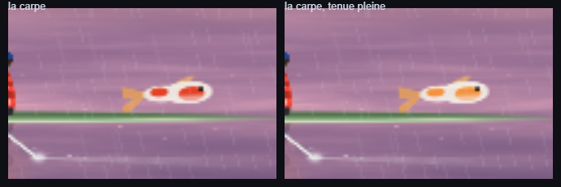
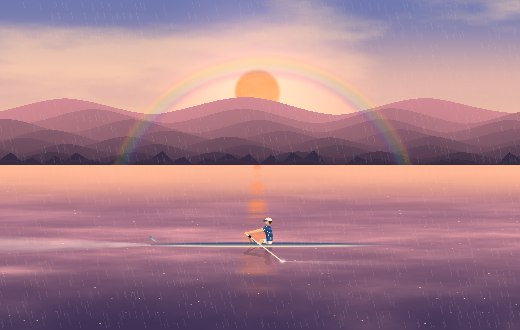
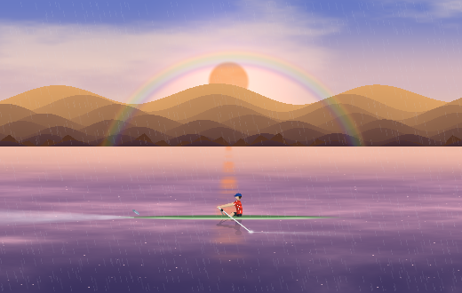
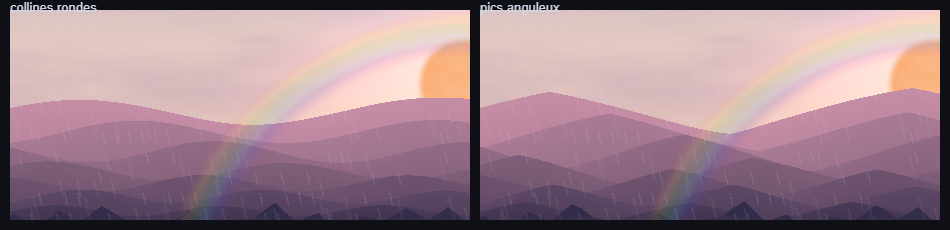
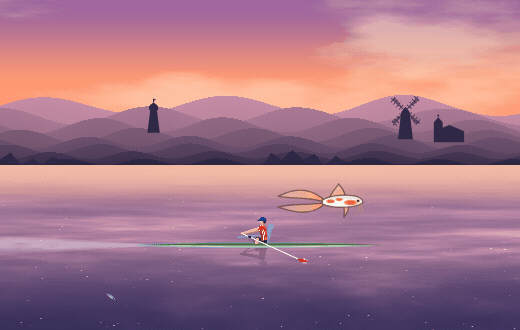
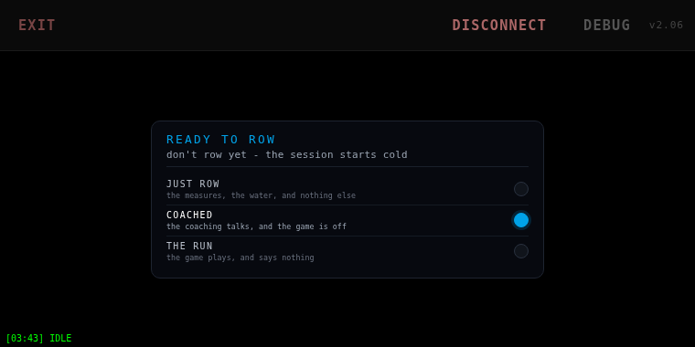

# Le concept de la gamification

> Une lecture courte de ce que le jeu est aujourd'hui, après les lots 1 à 5.
> La conception détaillée, les mesures et l'historique des lots sont dans
> [GAMIFICATION.md](GAMIFICATION.md). Ce document raconte l'idée.

## L'idée, en une phrase

**Une séance libre d'aviron devient une course silencieuse.** Le score vient de
l'élévation de cadence *au-dessus de sa propre norme*, et le monde devient plus
beau quand on pousse — jamais l'inverse. Personne ne lit un mot pendant la
course, et personne ne rate rien.

## Le point de départ : Alto's Odyssey

Alto's Odyssey est un runner sans fin : on tape pour jouer, le score vient du
**style**, la **vitesse est la conséquence**, et le monde réagit quand le joueur
est en forme. Personne n'a jamais vu Alto dire « va plus vite ».

| Alto's Odyssey | XEsync Rowing |
| --- | --- |
| Le runner est infini | La séance est la course, sans ligne d'arrivée |
| On tape pour jouer | On tire : **la cadence est la manette** |
| Les figures rapportent des points | L'élévation de cadence au-dessus de sa propre norme rapporte des points |
| Le combo se perd si on plante | La chaîne se vide si on décroche, un palier à la fois |
| Le monde accélère quand on enchaîne | La scène accélère, le jour tourne plus vite, la traînée grandit |
| Le défi du jour, identique pour tous | La Course du Jour, tirée de la date |
| Le meilleur run | Le Fantôme de son propre meilleur passage |
| *(rien)* | **La carpe** que la poussée appelle |

La transposition a une seule règle de fond : **dans Alto, la vitesse est
l'effet d'un jeu, jamais son objectif déclaré.** L'inverse est un exerciseur.

---

## 1. La règle unique : votre propre norme

Tout le jeu tient dans deux nombres, et ils sont **continus** — pas de seuil,
pas de falaise :

```
NORM = médiane de la cadence des 30 dernières secondes
LIFT = cadence du moment − NORM
```

- **LIFT > 0** → la chaîne monte, d'autant plus vite que LIFT est fort ;
- **LIFT ≤ 0** → la chaîne se vide.

Trois propriétés en découlent :

1. **La norme ne demande jamais l'impossible.** Elle est tirée de ce que la
   personne vient de faire, pas d'un standard.
2. **La norme suit l'effort.** Pousser la fait monter, décrocher la fait
   redescendre : c'est un **cliquet réversible**. Plus on pousse, plus il faut
   pousser.
3. **Elle ne harcèle jamais.** Personne ne reçoit « accélère ».

Le HUD montre une barre deux coups/min au-dessus de la norme — c'est une
**valeur d'affichage**, pas une porte à franchir. La chaîne ne dépend que du
LIFT, et le LIFT n'a pas de seuil.

### Pourquoi continu, et pas binaire

Une première version utilisait une barre et une condition de flux binaire
(`cadence ≥ barre`). Mesurée sur des séances simulées, elle ne tient pas : la
cadence instantanée d'une machine réelle oscille de quelques dixièmes de
coup/min, et la décision passait de 0 % à 99 % du temps en flux selon un
demi-point de seuil. **C'est une falaise, pas un jeu** — et le bruit réel du
rameur n'est pas connu d'avance.

L'élévation supprime le seuil : un petit changement de réglage ne renverse
rien, et un seul paquet raté n'achève pas une bonne course.

---

## 2. La chaîne

Le flux produit une **chaîne** continue, comparable au combo d'Alto :

- un palier toutes les **10 secondes** d'élévation, au carré : à +3 coups/min
  au-dessus de sa norme, c'est un palier toutes les 10 s ; à +6, deux fois plus
  vite ;
- le compteur est **continu** (une « chaleur » entre 0 et 5), pas une liste de
  paliers : le travail vers un palier n'est perdu que partiellement ;
- hors élévation, la chaîne **saigne** — mais après **8 s de grâce**, puis un
  palier toutes les 6 s. Elle ne casse pas d'un coup ;
- le multiplicateur va de **×1 à ×6**.

L'exposant au carré est ce qui empêche l'échauffement de remplir la chaîne : un
échauffement est une rampe lente, la norme traîne derrière elle, et le LIFT
reste un petit peu positif pendant des minutes — intégré dans le temps, cela
bat une poussée franche. La chaîne doit récompenser l'**intensité**, pas la
durée.

---

## 3. Le score

- **Le terrain compte toujours** : 10 points par mètre, même hors élévation,
  même avant que la norme existe. Une course ne vaut jamais zéro, et un rythme
  calme n'est jamais puni.
- **En flux**, le mètre vaut le terrain × la chaîne × un coefficient
  d'excès (×1 à ×2 selon l'élévation).
- Un palier vaut **+100 × multiplicateur**, une poussée **+250 × multiplicateur**,
  une carpe **+2 000 × multiplicateur**.

Le score est **personnel** : un passage à 20 coups/min et un passage à 30
coups/min ne sont pas comparables. Tant qu'il n'y a pas de référence commune,
le classement mondial n'existe pas.

---

## 4. La poussée — la mesure qui compte

Une **poussée** est un LIFT d'au moins **2,5 coups/min tenu cinq secondes**.

La durée compte autant que le niveau : le bruit de la machine atteint 2,5 sur un
échantillon, mais ne le tient jamais cinq secondes d'affilée. Une poussée est
donc un **effort**, pas un pic.

C'est aussi ce qui la sépare du LIFT seul. Sur une rampe tenue, le bruit porte
l'élévation jusqu'à 2,7 coups/min (pire cas de la grille de simulation) ;
une vraie poussée ne dépasse pas 3,0. **L'élévation ne sait pas distinguer un
effort d'un pic ; la poussée si.**

Ce qu'elle fait :

- elle paie (250 × multiplicateur) ;
- elle **rehausse la norme** pour les trente secondes qui suivent : le risque
  est dans la mécanique, pas dans une règle cachée ;
- elle **appelle la carpe**.

---

## 5. La carpe

**La poussée l'appelle. La chaîne la garde.**

- Une fois là, elle se **tient** : **15 secondes** avec la chaîne, et elle est
  pêchée. Elle n'est pas attrapée, elle est gardée — une séance d'aviron n'a pas
  de réflexe, et une récompense qui en demande un ne lui va pas.
- Si le rameur lâche la chaîne plus de **8 secondes** (la même grâce que la
  chaîne), elle replonge. **Rien n'est dit** : une carpe qui n'a pas été pêchée
  n'est pas un échec, elle ne laisse aucune trace.
- Elle vaut **2 000 points × la chaîne** (4 000 à ×2, 8 000 à ×4). Le terrain
  vaut ce qu'il valait avant : la carpe est un **bonus**, jamais une condition.

**Ce qu'on voit.** Elle nage à côté du bateau, sur la houle, et **le rouge
se réchauffe vers l'or à mesure que la tenue se remplit** : le rameur est renseigné sans
un mot, dans la langue que la scène parle déjà. Un halo doré et quelques
étincelles s'allument quand la tenue est assez avancée pour mériter d'être
annoncée.



*À gauche la carpe ; à droite, la tenue pleine : elle prend la lumière.*

**Ce qui est dit.** Une ligne dans le bilan de fin de séance — `koi landed` — et
une petite marque rouge sur la carte de séance. Rien d'autre : pas de compteur,
pas de collection, pas de relance.

**Ce qu'elle n'est pas** : ni une consigne, ni une cible (« koi 3/15 » n'existe
nulle part), ni une punition, ni une série, ni une comparaison.

---

## 6. La Course du Jour

Une course **identique pour tout le monde**, tirée de la date et de l'heure.

- Les **conditions du jour** (météo, thème de l'image) sont tirées d'une graine
  date + heure : le shader sait déjà varier par jour, la scène le suit.
- Le **par du jour** se dit en deux mots de jeu : un multiplicateur à atteindre
  (×2, ×3 ou ×4) et un nombre de poussées (1 à 3).
- Quand il est atteint, le HUD s'encoche et le ciel change. **Aucun mot** : le
  par est une marque, pas une récompense.

---

## 7. Le Fantôme

Ramer contre son propre meilleur passage.

- Le profil vient des séances que le serveur a déjà (`list_workouts`,
  `get_workout`) : **aucune donnée nouvelle, aucune migration**. Seuil :
  1 000 m et 4 minutes.
- La comparaison est **au même temps écoulé**, pas à la même distance : le
  fantôme est là où *vous* étiez à cette seconde-là. C'est la seule comparaison
  qui veuille dire quelque chose.
- Il rame **à son propre rythme** : sa phase de rame est intégrée de sa
  propre cadence. Ce n'est pas votre double, c'est ce que vous avez fait la
  dernière fois.
- L'écart est borné à 400 m ; il est une silhouette translucide, pas un double
  opaque.
- À la fin de la séance, une seule ligne : « N m devant le fantôme » ou
  « N m derrière le fantôme ». Le résultat est réglé **au temps écoulé le plus
  court des deux courses** : personne ne rame plus longtemps pour rester devant.
- Hors ligne, le profil est **mis en cache sur le téléphone** : une séance
  commencée sans réseau porte quand même son fantôme.

---

## 8. L'habillage, et le décor qui suit

### Ce que le rameur porte

La **livrée** (la coque) et le **maillot** viennent du **nombre de séances
faites**. Une livrée se gagne en revenant, pas en étant meilleur que quelqu'un
— un rameur de loisirs et un rameur d'entraînement atteignent les mêmes coques à
la même vitesse.

| Séances | Livrée | Lieu |
| --- | --- | --- |
| 0 | les couleurs du club | les conifères |
| 5 | la rayure | la clairière |
| 15 | le vernis de l'aube | l'automne |
| 40 | le vernis de la nuit | les neiges |
| 100 | la coque d'or | la côte d'or |

Le **thème** vient de l'heure du jour : un étalonnage posé sur toute l'image,
comme un grade de cinéma, quelques pour cent par canal. C'est le même pour
tout le monde au même moment, et c'est volontairement **tendre** — un thème qui
s'imposerait serait un effet, pas une météo.

**L'habillage n'est pas un magasin, pas une barre de progression, pas un
score.** Rien ne s'achète, rien ne se configure, l'app ne dit jamais « plus que
deux séances et vous aurez la rayure ». La livrée change, et la scène le montre.

**Le changement s'annonce avec de la lumière** : un balayage qui traverse le
monde — les collines d'abord, puis la coque — et qui dure 2,2 s sur l'horloge
réelle.



*À gauche, les couleurs du club ; à droite, la rayure — le maillot suit la coque.*

### Ce que le monde fait

Le décor change sur **la même progression que la coque** : un nouveau bateau est
aussi un nouvel endroit.



*Le même endroit, quinze séances plus tard : les collines, les pins, l'air.*

Et surtout, **le décor répond** :

- quand la chaîne monte, **les collines respirent** plus fort et les pins se
  penchent dans le vent ;
- la crête glisse **lentement** vers un profil triangulaire : même amplitude,
  même longueur d'onde — la montagne change de forme, pas de taille — avec une
  inertie d'une trentaine de secondes et un plafond à 75 %. La montagne change
  comme un paysage change au fil d'une matinée, pas comme un interrupteur ;
- **les repères sont sur la crête** : un village de deux ou trois cottages, un
  moulin dont les ailes tournent sur l'horloge, un clocher, une tour à dôme.
  Ils sont posés sur la même ligne de crête que les pins (la math du shader
  portée en JS), et échantillonnée aux deux bords de leur emprise, pour qu'une
  maison à pied plat ne se retrouve pas en équilibre sur une seule pointe.
  Ils sont sur la **crête du milieu**, pas sur celle du premier plan : posés sur
  la crête la plus rapide du paysage, un village filait deux fois plus vite que
  les collines qu'il habite, et lisait comme un autocollant qui glisse sur le
  décor. Au milieu du tableau, ils défilent à la vitesse du paysage (0,22 au
  lieu de 0,40), et le premier plan garde sa vitesse — c'est le premier plan,
  et la vitesse est le but du jeu.



### La scène, en mouvement

La scène n'a été regardée qu'en photos fixes jusque-là. Elle tourne maintenant :
[`tests/e2e/scene-loop.js`](../tests/e2e/scene-loop.js) charge la vraie page,
laisse tourner la vraie boucle d'animation et saisit l'image composée après
chaque dessin (le WebGL, puis le décor par-dessus, puis la carpe par-dessus) —
c'est l'app, en mouvement, pas une reconstitution.



Trois choses que ces images ont fait corriger :

- **le fantôme ramait à l'envers.** Il avait sa propre pose — un torse qui ne
  bougeait pas, une rame qui balayait dans l'autre sens — et passait pour un
  miroir du rameur plutôt que pour un rival. Il prend maintenant les **mêmes
  keyframes** que le joueur, à sa propre phase : mêmes sept articulations,
  même œillet de rame, même pale. Sa phase est remise sur la piste du joueur
  avant de partir au shader, parce que le profil compte ses tractions depuis la prise
  d'eau et le traqueur les compte depuis la fin de l'appui.
- **la carpe apparaissait de nulle part.** Elle était déjà à sa station, en
  pleine eau, à l'instant où la chaîne l'appelait. Elle **remonte des
  profondeurs**, elle **se rapproche du bateau** à mesure que la chaîne est
  tenue, et elle **plonge** quand la chaîne casse — au lieu de disparaître
  d'un coup. La capture est quelque chose qu'on regarde se produire.
- **les lucioles étaient des lanternes.** Roses, bleues et blanches, avec un
  halo deux fois trop large. Elles sont **jaunes**, et le halo fait la moitié
  de la taille.

---

## 9. Les trois façons de ramer

La couche de jeu n'est pas une religion, et le coaching non plus. Il y a
**trois façons de ramer**, choisies sur l'écran qui attend la première
rame — celui qui dit *ne rame pas avant le départ*, parce qu'une séance
part toujours à froid : le score, la chaîne et l'élévation recommencent à
zéro.



| | **JUST ROW** | **COACHED** | **THE RUN** |
|---|---|---|---|
| Le coaching (messages, jalons, défis) | | ✓ | |
| Le score, la chaîne, le par du jour | | | ✓ |
| Le fantôme, l'habillage, la carpe | | | ✓ |
| Le jour qui tourne, la pluie, l'aurore | ✓ | ✓ | ✓ |

- **JUST ROW** — les mesures, l'eau, et rien d'autre. La scène reste ce
  qu'elle est, les collines restent rondes, la coque porte les couleurs
  d'avant l'habillage. C'est l'ancien mode calme : le même silence, mais
  cette fois il se lit comme un choix et pas comme un réglage.
- **COACHED** — le coaching parle : messages, jalons, le défi « Sprint
  X m ». Le jeu, lui, est éteint. C'est le mode par défaut.
- **THE RUN** — le jeu joue, et ne dit rien : la chaîne fait bouger le
  monde, le score compte, le fantôme est sur l'eau, la carpe vient.

**La voix et le jeu ne coexistent pas.** Les trois choix sont exclusifs :
un rameur qui veut les deux doit en choisir un, et l'app ne demande pas
lequel — elle propose les trois et garde la réponse.

**Le jeu ne peut pas être à moitié.** Le score, le par du jour, le
fantôme, l'habillage et la carpe s'allument ensemble ou s'éteignent
ensemble : il n'y a pas six interrupteurs, il y a trois façons de ramer.

**La météo n'appartient à personne.** Le cycle jour/nuit, la pluie et
l'aurore tournent dans les trois modes : c'est la scène, pas le jeu. Seul
le *par* du jour est une marque du jeu, et il s'éteint avec lui.

Le choix est celui du téléphone (comme le mode coaching qu'il remplace) :
rien n'est synchronisé, rien n'est demandé au serveur.

## 10. Ce que le jeu ne fera jamais

- ❌ **Pas de séance d'entraînement.** Aucun intervalle, aucune pyramide, aucune
  cible de distance, aucun chronomètre de série, aucun écran de préparation. On
  configure rien avant de ramer.
- ❌ **Pas d'injonction.** Jamais « accélère », jamais « tu devrais », jamais de
  commentaire sur la technique ou l'état physique : les données ne permettent
  pas de l'évaluer.
- ❌ **Pas de culpabilisation.** Pas de série à perdre, pas de reproche, pas de
  comparaison avec les autres pendant l'effort. Ramer et s'arrêter restent des
  options neutres.
- ❌ **Pas de score non comparable.** Le score reste personnel.
- ❌ **Pas de doublon avec le coaching.** Le coaching parle, le jeu montre. Un
  seul message à la fois.
- ❌ **Pas de magasin, pas de barre de progression.**
- ❌ **Pas de mot dans la scène.** Le jeu se voit, il ne parle pas.

---

## 11. Comment c'est fait

Deux couches qui ne se connaissent pas :

```
   paquet FTMS ──► couche de jeu (run_score.js)  ──► couche de jeu calcule
        │                    │
        │                    └──► chainLevel (0..1) ──► scène (u_chain)
        └──► couche verbale (coaching) ──► coaching parle
```

- **Les règles sont pures** : `run_score.js` (score, chaîne, poussée, carpe),
  `daily_course.js` (Course du Jour), `ghost.js` (Fantôme), `costume.js`
  (habillage), `game_modes.js` (les trois façons de ramer) — cinq modules sans DOM, sans
  réseau, sans timers, testés sans navigateur (`node --test tests/*.test.js`).
- **Un seul point de contact** avec la scène : `RunScore.chainLevel(state)` →
  `setChainLevel(level)` → l'uniform `u_chain`. Le coaching ignore que la scène
  existe ; la scène ignore qu'on rame.
- **Un mode agit sur la règle, pas sur l'affichage** :
  `RunScore.setFishEnabled()`, `Costume.plain()`, et le `runScore` du payload
  sans son score. Éteint, ce n'est pas caché — c'est absent.
- **La carpe et les repères sont en 2D**, sur leurs propres `<canvas>` posés
  au-dessus du canvas WebGL : un chemin de Bézier se dessine à la main, une
  SDF ne se dessine pas. La géométrie du bateau, elle, reste dans le shader.
- **Le serveur n'est jamais réécrit** : chaque nouveau chiffre est une
  **colonne additive** et une **RPC additive** (`run_score`, `daily_par_reached`,
  `koi_landed`), parce que `list_workouts` ne peut pas changer son type de
  retour. Le payload complet de la séance est archivé verbatim en JSONB.

---

## 12. Ce qui n'est pas encore vérifié

- **Le rendu animé n'a jamais été vu sur un vrai GPU.** Le sandbox de
  développement n'a pas de GPU : le shader est compilé, lié et comparé pixel
  par pixel dans un vrai contexte WebGL (`tests/e2e/shader.spec.js`), et
  `tests/e2e/scene-loop.js` en tire une animation complète (l'app réelle, au
  ralenti) — mais sur un vrai GPU, **la première chose à regarder sur le
  téléphone**. La scène ne s'est jamais vue qu'à 0,6 image par seconde.
- **Le bruit réel du XEBEX est inconnu.** Les constantes sont calibrées sur une
  grille simulée (`dev/sim_session.js`, `dev/calibrate.js`), pas sur une séance
  réelle : elles sont justes *à l'intérieur de la grille*, et une vraie séance
  permettrait de les corriger.
- **Le retard de l'animation est mesuré, mais pas jusqu'au bout.** Le traqueur
  accroche le cycle de rame aux ticks du rameur, qui arrivent **une fois par
  seconde** et disent seulement « une traction a eu lieu » : chaque traction est
  donc connue à la demi-seconde près, et le filtre ramène ça à environ 0,1 s de
  tremblement. `dev/phase_lag.js` le mesure : **0,09 à 0,19 s** en allure
  stable, **0,23 s** sur une rampe de tempo (le cas d'un rameur qui pousse — il
  regarde l'animation à ce moment-là). Ce qui reste **sur le bateau**, en plus,
  c'est le délai de livraison du Bluetooth, sous l'app. La seule chose que le
  logiciel ne peut pas faire, c'est devenir plus fin que le paquet.
- **Le score n'est pas comparable entre personnes**, et le fantôme n'est pas
  encore fair au-delà de 400 m d'écart.

---

## Voir aussi

- [GAMIFICATION.md](GAMIFICATION.md) — la conception, les mesures, l'historique
  des lots.
- [ARCHITECTURE.md](ARCHITECTURE.md) — où vivent les règles et la scène.
- `dev/calibrate.js` — rejouer une séance vraie contre la grille de bruit.
- `tests/e2e/shader.spec.js` — le shader compilé et comparé pixel par pixel.
