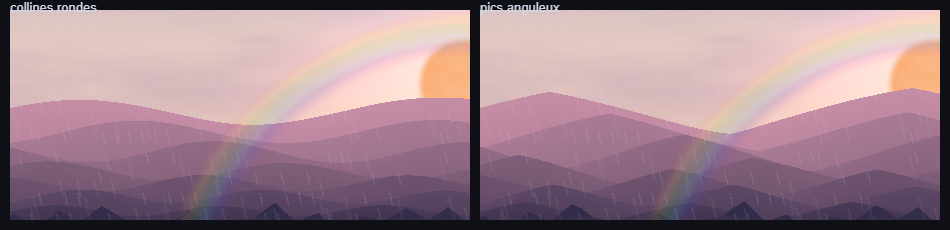
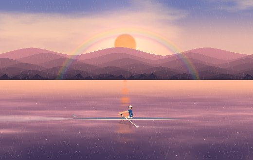
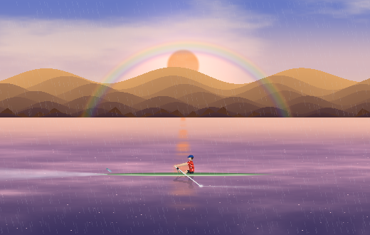
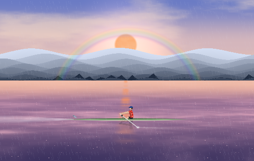
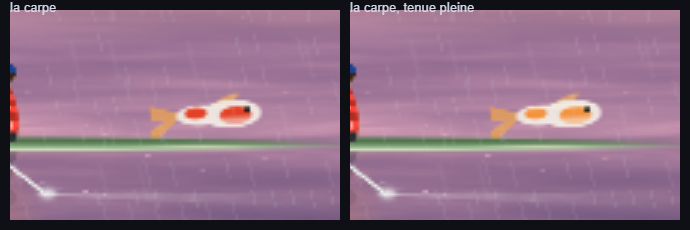
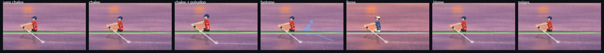

# XEsync Rowing — Gamifier sans transformer l’app en salle de sport

> Proposition produit — 19 novembre 2026. Elle prolonge `AMELIORATIONS_PRODUIT.md` (qui
> décrit l’accompagnement et les jalons, déjà implémentés) en ajoutant une couche de jeu.
> Idées à tester, pas fonctionnalités déjà disponibles.

## La contrainte qui commande tout

Le parcours actuel est déjà le bon : une séance libre, sans programme, sans durée à choisir,
sans écran de préparation. Le coaching observe et commente. Ce document ne touche pas à ça.

**Interdit :** une séance d’entraînement classique. Pas de « 6 × 500 m », pas de pyramide, pas
de cible de distance à valider, pas de chronomètre de série, pas d’écran de configuration
avant de ramer, pas de « contrat » d’entraînement. Ce qui existe déjà doit continuer à ressembler à
« je rame, l’app fait quelque chose ».

**Demandé :** lrugby d’Alto’s Odyssey. Le jeu ne dit jamais « accélère ». Le monde répond au
joueur, et le joueur veut accélérer parce que c’est plus beau.

## Alto’s Odyssey, transposé

Alto’s Odyssey est un runner sans fin, procédural, où l’on tape pour jouer. Le score vient du
**style** (figures, combos), la distance vient de la vitesse, et le monde se met à réagir quand
le joueur est en forme. Personne n’a jamais vu Alto dire « va plus vite ».

| Alto’s Odyssey | XEsync Rowing |
| --- | --- |
| Le runner est infini | La séance est la course, sans ligne d’arrivée |
| On tape pour jouer | On tire : **la cadence est la manette** |
| Les figures rapportent des points | L’élévation de cadence au-dessus de sa propre norme rapporte des points |
| Le combo se perd si on plante | La chaîne se vide si on décroche, un palier à la fois |
| Le monde accélère quand on enchaîne | La scène accélère, le ciel change plus vite, la traînée grandit |
| Le défi du jour, identique pour tous | La Course du Jour, tirée de la date |
| Le meilleur run | Le fantôme de son propre meilleur passage |

Le point important : **dans Alto, le score vient du style et la vitesse est la conséquence**.
L’inverse est un exerciseur. Il faut que la vitesse soit *l’effet* d’un jeu, pas son objectif
déclaré.

## Le cœur : votre propre norme, et l’élévation au-dessus

Tout le jeu tient dans deux nombres, et ils sont **continus** — pas de seuil, pas de falaise.

```
norme  = médiane de la cadence des 30 dernières secondes
élévation = cadence du moment − norme
```

L’élévation est la quantité qui décide de tout :

- **élévation > 0** → la chaîne monte, d’autant plus vite que l’élévation est forte ;
- **élévation ≤ 0** → la chaîne se vide.

Trois propriétés en découlent :

1. **La norme ne demande jamais l’impossible.** Elle est tirée de ce que la personne vient de faire,
   pas d’un standard.
2. **La norme suit l’effort.** Pousser la fait monter, décrocher la fait redescendre. C’est un
   **cliquet réversible** : plus on pousse, plus il faut pousser.
3. **Elle ne harcèle jamais.** Personne ne reçoit « accélère ».

C’est exactement la courbe de difficulté d’Alto : le jeu vous rejoint où vous êtes et vous
maintient au bord.

### Ce qui compte : l’élévation

- **Le terrain toujours.** Chaque mètre parcouru vaut des points, **même hors élévation**. Une
  course ne paie jamais zéro : vingt minutes à rythme tranquille valent quelque chose, elles
  construisent simplement pas de chaîne. **Un rythme calme n’est jamais puni.**
- **La chaîne.** Un palier toutes les 10 s d’élévation, et le palier arrive d’autant plus vite
  que l’élévation est forte (1,5 coup/min au-dessus de la norme = un palier toutes les 10 s).
- **Le coefficient.** Un mètre parcouru avec de l’élévation vaut jusqu’à **×2** selon
  l’élévation. Celui qui reste à sa norme marque ×1, celui qui monte à +4 au-dessus marque ×2
  sur chaque mètre — et couvre en plus de terrain par seconde.

### Le risque est dans la mécanique, pas dans une règle

Pousser fait monter la norme. La_norme suit, l’élévation rétrécit. **Maintenir une élévation
est un travail** : au bout d’une quinzaine de secondes à +6 coups/min, la norme a rattrapé et
l’élévation est retombée à zéro — la chaîne se vide alors que la cadence n’a pas bougé.

Il n’y a pas de « risque » à expliquer ni de pénalité cachée : **la poussée relève votre propre
norme**, et c’est tout. C’est le backflip d’Alto : une tentative délibérée, rémunérée, qui peut
vous laisser dans une position plus difficile qu’avant.

### Pourquoi continu et pas binaire

Une première version utilisait une **barre** et une condition de flux binaire
(`cadence ≥ barre`). Mesurée sur des séances simulées, elle ne tient pas : la cadence
instantanée d’une machine réelle oscille de quelques dixièmes de coup/min, et la décision
passait de 0 % à 99 % du temps en flux selon un demi-point de seuil. **C’est une falaise, pas un
jeu** — et le bruit réel du rameur n’est pas connu d’avance.

L’élévation supprime le seuil : plus la cadence est haute au-dessus de la norme, plus la chaîne
monte vite. Le résultat est continu, et un petit changement de réglage ne renverse rien.

## La chaîne

Le flux produit une **chaine** continue, comparable au combo d’Alto :

- Un palier toutes les **10 secondes** d’élévation, et d’autant plus vite que l’élévation est
  forte : ×1, ×2, ×3… jusqu’à ×6.
- Le compteur est **continu** (une « chaleur » entre 0 et 5), pas une liste de paliers : le
  travail vers un palier n’est pas perdu quand on décroche, seule la fraction l’est.
- Hors élévation, la chaîne **saigne** d’un palier toutes les 3 secondes. Elle ne casse pas d’un
  coup : un paquet raté ne doit pas achever une bonne course.
- Le score vient du terrain parcouru, multiplié par la chaîne et par le coefficient **quand il y
  a élévation**, et au taux de base sinon.

C’est le premier système de score de l’application : aujourd’hui il n’existe ni score, ni
combo, ni série dans le code.

## Ce que la simulation a montré

Les règles ci-dessus ne sont pas des intentions : elles ont été passées sur des séances
simulées de 10 minutes, avec la même wobble de cadence que le simulateur de l’app
(`debug_sim.js`, ±0,8 coup/min). Le script est dans `dev/balance_sim.js`.

| Profil de séance | Chaîne max | Score (base ×100) |
| --- | --- | ---: |
| Régulier à 26 coups/min | ×1 | 100 |
| Régulier à 20 coups/min | ×1 | 77 |
| Une poussée de 20 s à 32 | ×6 | **145** |
| +5 coups/min tenus 6 min | ×6 | **157** |
| Fractionné 31 / 22 | ×6 | **293** |
| Fatigue 26 → 20 | ×1 | 87 |

Ce qu’on en tire :

- **Un rameur régulier ne construit aucune chaîne.** Il garde les points de base. La chaîne se
  gagne, elle ne se reçoit pas.
- **Pousser paie** : +45 % pour une poussée de 20 s sur une séance de 10 min, +57 % pour un
  effort tenu. Le fractionné, parce qu’il recommence, paie presque triple.
- **La fatigue n’est pas une punition** : la chaîne s’éteint, les points de base restent (87 %).
- **Il n’y a pas de falaise.** Faire varier le réglage d’un palier de 1,0 à 2,5 coups/min
  déplace les ratios de 145 % à 122 %, sans discontinuité.

La version précédente, à seuil binaire, est documentée ci-dessus : elle donnait 0 % ou 99 % de
temps en flux selon un demi-point de seuil, et la chaîne ne se construisait jamais. C’est la
simulation qui l’a fait abandonner.

## L’incitation qui compte : la scène

C’est le point où Alto et une app de sport divergent, et c’est le plus important de ce
document.

Dans Alto, le joueur n’a jamais besoin qu’on lui dise d’aller plus vite : **le monde devient plus
beau quand il joue bien**. La caméra bouge, la lumière change, le monde défile.

XEsync a déjà l’infrastructure : le shader de `rowing_display.html` est procédural et expose
déjà `u_day` (cycle de 300 s qui fait varier la météo), `u_speed` (vitesse de défilement) et
`u_scale` (taille du sprite, aujourd’hui constante et inutilisée).

Il suffit d’un nouvel uniform **`u_chain`** (0..1, le niveau de chaîne) pour que :

(Attention au nom : `u_flow` existe déjà dans le shader, c’est la coordonnée de défilement du
décor. Le nouveau uniform s’appelle donc `u_chain`.)

- la scène défile plus vite quand la chaîne monte (la réactivité est déjà là via `u_speed`) ;
- **le jour avance plus vite** — plus de météo, plus de lumière, plus de Syrthes visibles ;
- la traînée et l’écume grandissent, le sprite prend un peu d.scale ;
- la caméra s’incline un peu plus sur les paliers.

**Aller plus vite doit être plus beau.** C’est là toute l’incitation, et elle ne coûte pas un
seul mot à l’écran. Personne ne reçoit une injonction : le joueur voit simplement que la course
devient plus vivante quand il pousse.

Le score, lui, reste discret, en permanence, dans le coin — comme le compteur d’Alto.

## Ce que l’on peut greffer, et où

Le code a déjà les coutures. C’est le principal enseignement de l’exploration : la couche de jeu
n’a pas besoin d’architecture nouvelle.

| Élément | Où | Comment |
| --- | --- | --- |
| Mesures par paquet | `ftms_integration.js:541-549` | Le snapshot `{activeSeconds, distance, strokes, spm, watts}` existe déjà et arrive à chaque paquet actif. |
| Règles pures, sans DOM | `coaching.js` | Le modèle est exactement le même : un module de règles qui reçoit des mesures et produit des événements. |
| Attacher un résumé à la séance | `controller.js:547-553` (`onBeforeSave`) | `payload.splitsTable` et `payload.coachingSummary` y sont déjà attachés. Un `payload.runScore` suit le même chemin. |
| Stocker sans migration | `xesync.workout_data` (JSONB) | Le payload complet est archivé **verbatim**. Une clé racine nouvelle est conservée telle quelle, **sans migration serveur**. |
| Rendu dans la scène | `rowing_display.html` (uniforms) | `u_day`, `u_speed`, `u_scale` existent déjà ; il manque `u_chain` (`u_flow` est déjà pris par le défilement). |
| Les records | `localStorage` (`sprintBests_<user>`) | Le mécanisme existe déjà pour les records de sprint, mais il n’est **pas** synchronisé. |
| Histique et détail | `home.html` | Les cartes de séance sont déjà rendues : le score a sa place sur la carte. |

### La pile de jeu

Le cœur de scoring est écrit, testé et **câblé** : **`run_score.js`** (module pur, sans DOM ni
réseau, dans le style de `splits.js`) :

- `RunScore.createRun()` → l’état d’une course ;
- `RunScore.tick(state, snapshot)` → avance la course et renvoie l’événement à afficher
  (`flow_entered`, `flow_left`, `chain_up`, `chain_down`, `push`) ;
- `RunScore.summarize(state)` → le résumé à attacher au payload ;
- `RunScore.chainLevel(state)` → **le niveau de chaîne normalisé (0..1)**, la valeur que la scène
  consomme. C’est le seul point de contact entre le jeu et le rendu.

Le câblage passe par `controller.js` (`window.onFtmsTick` → `RunScore.tick` → `setChainLevel`) :
les deux couches ne se connaissent pas, la couche de jeu ne dit rien à la couche verbale et
réciproquement.

L’habillage (**`costume.js`**, module pur comme les autres) décide de ce que la scène
porte : la livrée de la coque, le maillot du rameur, le thème de l’heure. Le nombre de
séances faites entre, l’habillage sort. Il ne touche ni au score, ni à la chaîne, ni au
par — il ne fait qu’habiller.

## Les modes — des courses, pas des entraînements

Trois façons de jouer, aucune ne demande de configurer quoi que ce soit.

### 1. La Course (mode par défaut)

La séance libre, simplement scorée. C’est ce que le prototype implémente. Aucune édition, aucun
choix, aucun écran : on appuie sur SCAN et on rame.

### 2. La Course du Jour

Une course **identique pour tout le monde**, tirée de la date. Alto le fait chaque jour, et ça
marche parce que c’est court, commun, et qu’on peut le comparer.

- Les « conditions » du jour (vent, météo, palette) sont tirées d’une graine date + heure ;
- le décor change en conséquence : **le shader sait déjà varier par jour** ;
- un « par » du jour, et le même pour tout le monde.

Sans compte ni réseau, c’est déjà une course contre soi-même et contre la date. Avec le
classement, plus tard, c’est une raison de revenir.

### 3. Le Fantôme

Ramer contre son propre meilleur passage. Les échantillons sont déjà stockés côté serveur
(`xesync.workout_strokes`, reconstructibles par `get_workout`) : le profil distance-temps du
meilleur run peut être rejoué dans la scène.

C’est la mécanique de « aller plus vite » la plus directe qui soit, et **elle n’a besoin d’aucune
donnée nouvelle** — seulement d’un tracé dans le décor.

### Et le reste, plus tard

- **Les cosmetics** :ostos de rameur, peaux de bateau, themes de décor. Alto est autant un jeu
  de costumes qu’un runner ; c’est ce qui donne envie de revenir avec le temps.
- **Les événements de saison** : une semaine spéciale, un thème, un barème.
- **Le classement** : seulement quand les scores seront comparables entre personnes (voir les
  limites).

## Ce que ce n’est pas

- ❌ **Pas de séance d’entraînement.** Aucun intervalle, aucun plan, aucune consigne à suivre.
  On ne configure rien avant de ramer.
- ❌ **Pas d’injonction.** Jamais « accélère », jamais « tu devrais », jamais de commentaire sur
  la technique ou l’état physique — les données ne permettent pas de l’évaluer.
- ❌ **Pas de culpabilisation.** Pas de série à perdre, pas de notification de reproche, pas de
  comparaison avec les autres dans l’écran d’effort. Ramer et s’arrêter restent des options
  neutres.
- ❌ **Pas de score non comparable.** Un run à 20 coups/min et un run à 30 coups/min ne sont pas
  comparables. Tant qu’il n’y a pas de référence commune, le score reste **personnel** : « ton
  meilleur run », « ton plus long flux », « ton meilleur écart ». Le classement mondial ne vient
  qu’après, et seulement si on le veut.
- ❌ **Pas de doublon avec le coaching.** Le coaching parle ; le jeu montre. Un seul message à
  la fois, la couche de jeu n’ajoute pas de bannière concurrente.

## Lot 4 — l'habillage

Le jeu s'habille. Trois familles : le bateau, la terre, l'heure.

**La coque et le maillot** (le rameur) viennent de l'**histoire** : le nombre de séances
faites. Une livrée se gagne en revenant, pas en étant meilleur que quelqu'un — un rameur
de loisirs et un rameur d'entraînement atteignent les mêmes coques à la même vitesse.

| Séances | Livrée |
|---|---|
| 0 | les couleurs du club |
| 5 | la rayure |
| 15 | le vernis de l'aube |
| 40 | le vernis de la nuit |
| 100 | la coque d'or |

**Le thème** vient du **cours du jour** : une étalonnage posé sur toute l'image, comme un
grade de cinéma. C'est le même pour tout le monde à la même heure, et c'est volontairement
tendre — quelques pour cent par canal. Un thème qui s'imposerait serait un effet, pas une
météo.

**La première livrée est celle du bateau** : la scène est exactement ce qu'elle était avant
l'habillage. Le shader ne change pas de forme, il change de couleurs.

### Le décor aussi

Alto crée son ambiance par les montagnes et les arbres. Ici, ils étaient **figés** : huit
crêtes de couleurs écrites en dur dans le shader, et des pins d'une seule couleur. Le décor
ne changeait jamais, quelle que soit l'histoire du rameur.

Il change maintenant, sur la **même progression que la coque** — parce qu'un nouveau bateau
est aussi un nouvel endroit :

| Séances | Livrée | Lieu |
|---|---|---|
| 0 | les couleurs du club | les conifères |
| 5 | la rayure | la clairière |
| 15 | le vernis de l'aube | l'automne |
| 40 | le vernis de la nuit | les neiges |
| 100 | la coque d'or | la côte d'or |

Le shader ne dessine plus huit palettes : il dessine **deux couleurs de crête** — la brume
lointaine et la bande proche — et les huit bandes entre elles s'en déduisent. Les pins
prennent la couleur du lieu, et **la forêt change de densité** : la clairière est plus
clairsemée que les conifères, les neiges plus que la côte d'or. Le premier décor est
**exactement celui d'avant** : mêmes teintes, mêmes distances, mêmes arbres.

### Et le décor répond, lui aussi

L'eau répondait déjà à la chaîne (le scroll accélère, la trace se remplit). Les montagnes,
non : elles glissaient à la même vitesse que la crête, indifférentes.

Elles **respirent** maintenant : quand la chaîne monte, les collines ondulent plus fort et
les pins se penchent dans le vent. Un test le vérifie en ne comparant que **la moitié
haute de l'image** — si les collines ne bougeaient pas, rien en haut ne changerait.

Et elles **prennent des angles**. La crête a toujours été une sinusoïde : des dômes, rien
d'autre. Maintenant elle glisse vers un profil triangulaire — mêmes crans, même longueur
d'onde, même amplitude — donc la montagne ne change pas de taille, elle change de forme.
Les pins suivent la crête sur laquelle ils poussent, ils ne se détachent jamais.

Mais **lentement**. La forme du relief n'est pas un réflexe : elle suit la chaîne avec une
constante de temps d'une trentaine de secondes, et elle ne va jamais au bout du chemin (75 %
au maximum — les pics prennent des angles, ils ne deviennent pas une scie). La montagne
change de forme comme un paysage change au fil d'une matinée, pas comme un interrupteur.



### Ce que l'habillage n'est pas

- **Pas un magasin.** Rien ne s'achète, rien ne se configure, il n'y a pas de menu de
  costumes. Le bateau porte ce que l'histoire lui a mérité.
- **Pas une barre de progression.** L'app ne dit jamais « plus que deux séances et vous
  aurez la rayure » : ce serait une injonction, et le jeu ne donne pas d'injonction. La
  livrée change, et la scène le montre.
- **Pas un score.** Rien de tout ça ne peut être mieux ou pire. Ça ne se perd pas, ça ne
  change jamais la valeur d'une séance, ça ne compare personne.

### Le seul mot du jeu

Quand la livrée change pendant une séance, le bilan de fin de séance le dit — une fois,
dans le vocabulaire du jeu : `new livery: the racing stripe`. Et c'est tout. Le reste du
temps, rien ne se dit : la coque change de couleur, et le rameur change de maillot.

Sur l'eau, le changement s'annonce **avec de la lumière** : un balayage qui traverse le
monde — les collines d'abord, puis la coque — et qui dure 2,2 secondes sur l'horloge réelle
(c'est un moment de la scène qui se montre, pas une partie du monde qui s'accélère avec la
chaîne).



*À gauche, les couleurs du club ; à droite, la rayure — le maillot suit la coque.*



*Le même endroit, quinze séances plus tard : les collines, les pins, l'air.*



*Quarante séances : les neiges, et une forêt plus clairsemée.*

### D'où vient le nombre de séances

Du serveur, par la même liste de séances que le fantôme (`list_workouts`) : le nombre de
lignes est le nombre de séances. Il est **mis en cache sur le téléphone**, comme le
fantôme, pour qu'une séance commencée sans réseau porte quand même la bonne livrée.

Le seul endroit où l'habillage touche au score, c'est le résumé de la séance : il se
souvient de la livrée portée (`livery`), et de son changement (`livery.changed`). Rien de
plus — la livrée ne change ni le score, ni la chaîne, ni le par.

---

## Lot 5 — La Carpe ✅ livré

Le slot du lama d'Alto était vide. Le tableau de correspondance mappe tout le
runner d'Alto — le runner infini, le tape, les figures, le combo, le monde qui
s'accélère, le défi du jour, le meilleur run — mais pas la créature qu'on
attrape au passage. Ce qui s'en rapprochait le plus était la chaîne : c'est ce
qu'on pourchasse, mais c'est un compteur dans un anneau, pas un objet dans le
monde.

Il y a maintenant une carpe.

### Ce qui l'appelle

**La poussée.** Le jeu a déjà une mesure de l'effort soutenu : la poussée, qui
exige 2,5 coups/min au-dessus de sa propre norme, tenus cinq secondes. C'est
elle qui appelle la carpe.

Le pourquoi est mesuré, et c'est le même partout dans ce document : *sur une
rampe tenue, le bruit de la machine porte l'élévation à 2,7 coups/min* (pire
cas de la grille, `dev/sim_session.js`), *alors qu'une vraie poussée ne dépasse
pas 3,0*. L'élévation seule ne sait pas distinguer un effort d'un pic. La
poussée, si : le jitter du jamais atteint 2,5 pendant cinq secondes d'affilée.
C'est exactement pour ça que la poussée a été calibrée sur une durée, et non
sur un niveau.

Conséquence : un rameur régulier ne voit jamais de carpe, et un rameur qui
pousse la voit. Sur les quatre profils simulés (`node dev/sim_session.js
--sweep-lift`) :

| Profil | Poussées | Carpe |
| --- | ---: | --- |
| erg (échauffement + palier + une poussée) | 1 | apparue à 674 s, pêchée à 690 s |
| steady (cadence tenue) | 0 | — |
| sprint (course + sprint final) | 1 | apparition au sprint |
| short (10 min, échauffement) | 0 | — |

Et sur la grille de bruit, la carpe apparaît sur une rampe tenue **exactement
quand la poussée en apparaît** — ni plus tôt, ni plus souvent. La carpe n'est
pas plus maligne que le jeu qui l'appelle.

### Ce qui la garde

Une fois là, elle se **tient** : **quinze secondes** avec la chaîne. Elle n'est
pas attrapée, elle est gardée — une séance d'aviron n'a pas de réflexe, et une
récompense qui demande un réflexe ne lui va pas.

Si le rameur lâche la chaîne plus de huit secondes (la grâce, la même que
celle de la chaîne), la carpe replonge. La tenue est perdue avec elle, et
**rien n'est dit** : une carpe qui n'a pas été pêchée n'est pas un échec. Elle
ne laisse aucune trace, ni dans le bilan, ni dans l'historique.

Une carpe pêchée vaut **2 000 points, multipliés par la chaîne** — 4 000 à ×2,
8 000 à ×4. Le terrain, lui, vaut ce qu'il valait avant : la carpe est un
bonus, jamais une condition. Un test le vérifie (`tests/run_score.test.js`) :
la différence de score entre deux mêmes courses, l'une avec la carpe et l'autre
avec la carpe à zéro, est **exactement** le bonus.

### Ce qu'on voit

La carpe nage à côté du bateau, un peu en avant, sur la houle. Elle bat de la
queue — la queue est une onde, pas un drapeau : la pointe voyage plus loin que
la racine. Et **le rouge warms vers l'or quand la tenue se remplit** : le
rameur est renseigné sans un mot, dans la langue que la scène parle déjà.



*À gauche la carpe ; à droite, la tenue pleine : elle prend la lumière.*

Le rendu est dans le shader, comme le fantôme : `u_fishOn`, `u_fishX`,
`u_fishHold` et `u_fishFade`, et une carpe faite de SDF — le corps en deux
ellipses pour qu'il fuse vers la queue, la queue en deux lobes, la nageoire
dorsale, l'œil. Le tout dans un `if (u_fishOn > 0.5)`, pour ne payer le coût
que quand elle est là.

La position suit la largeur de la scène : sur un écran étroit, la carpe nage
plus près du bateau, sinon elle sort du cadre.

### La trace

- **Le bilan de fin de séance** dit « koi landed », une fois, dans le vocabulaire
  du jeu — comme « daily par reached » et « new livery ».
- **La carte de séance** porte une petite marque rouge, comme la marque dorée du
  par du jour. Pour cela : une colonne (`workouts.koi_landed`) et une RPC
  **additive** (`list_workout_kois`) — le même schéma que le score et le par,
  parce que `list_workouts` ne peut pas changer son type de retour.
- **Rien d'autre.** Pas de compteur, pas de collection à affichage, pas de
  message de relance.

### Ce que la carpe n'est pas

- ❌ **Pas une consigne.** L'app ne dit jamais « accélère ». Ce qui appelle la
  carpe, c'est une poussée au-dessus de sa propre norme — donc relatif, et
  jamais « plus vite » en général.
- ❌ **Pas une cible.** Personne ne lit « koi 3/15 » nulle part. La carpe se
  voit dans la scène, et sa tenue se lit dans sa couleur.
- ❌ **Pas une punition.** La rater ne coûte rien et ne se dit pas.
- ❌ **Pas une série.** Une carpe ne s'accumule pas : elle se pêche, et la
  séance suivante repart de zéro.
- ❌ **Pas une comparaison.** La carpe est à celui qui l'a pêchée, comme le
  score.

---

## Limites à connaître avant de construire

| Limite | Conséquence | Réponse |
| --- | --- | --- |
| Le rameur n’envoie qu’un paquet par seconde environ | La cadence instantanée est bruitée de quelques dixièmes | Médiane sur 3 échantillons pour la cadence, médiane sur 30 s pour la norme ; l’élévation est continue, pas un seuil |
| L’app ne connaît pas les capacités de la personne | Aucune cible absolue possible | La norme est relative à l’effort récent, par construction |
| Pas de capteur cardiaque exploitable pour jauger la fatigue | On ne peut pas adapter à l’état | On ne prétend pas le faire : le jeu ne parle que de cadence et de distance |
| Les scores de personnes différentes ne sont pas comparables | Pas de classement global sans référence | Le score reste personnel ; le « par » du jour est le seul point de comparaison |
| Le niveau de chaîne est une abstraction | Peut sembler arbitraire | Le prototype est fait pour être réglé : tous les paramètres sont en tête de `run_score.js` |

## Phasage

### Lot 1 — La course ✅ livré

- ✅ `run_score.js` câblé sur le snapshot de `ftms_integration.js` (même source que le
  coaching, aucun couplage entre les deux couches).
- ✅ Une puce discrète en bas de l’écran de rame : le score, un anneau qui se remplit avec la
  chaîne, la barre d’élévation. L’anneau passe au vert quand il y a élévation — c’est la seule
  chose colorée, et elle suffit.
- ✅ `payload.runScore` attaché à la sauvegarde. Le résumé complet est archivé verbatim dans
  `workout_data` (JSONB) : **aucune migration pour le stockage**.
- ✅ Une colonne `workouts.run_score` pour le seul chiffre dont l’application a besoin, et une
  RPC **additive** `list_workout_scores` — `list_workouts` garde sa signature, parce que
  Postgres refuse de changer le type de retour d’une fonction existante.
- ✅ Le score affiché sur la carte de séance (`home.html`) et dans le bilan de fin de séance.
- ✅ **Aucun texte, aucun message.** Le jeu se voit, il ne parle pas.
- ✅ La puce est masquée en mode calme (`Just Row`), qui promet un écran réduit aux mesures. La
  course continue d’être comptée et enregistrée : seule l’affichage se tait.

Deux défauts trouvés en le câblant :

1. **Les dix premières secondes n’étaient pas scorées** : sans norme, il n’y avait pas de point
   de base non plus. Une course pouvait donc finir à zéro. Le terrain compte désormais toujours,
   même avant que la norme existe.
2. **Le premier échantillon n’a pas de delta de distance** — il n’y a rien avant lui pour
   mesurer. C’est correct (le compteur du rameur est recalé à zéro au démarrage de la séance),
   mais il faut le savoir.

Le Lot 2 (la scène qui répond) est livré : c’est lui qui fait la différence entre un jeu et
une app de fitness avec des points.

### Lot 2 — La scène qui répond ✅ livré

La scène est maintenant un **instrument de jeu** : elle ne dit rien, mais elle bouge quand le
rameur tient sa cadence au-dessus de sa propre norme.

**Le passage de relais.** `RunScore.chainLevel(state)` produit un nombre entre 0 et 1 ;
`controller.js` le transmet à chaque paquet FTMS via `setChainLevel(level)` ; la scène s’en
sert pour `u_chain`. Le coaching et le jeu restent deux couches séparées : le coaching ne sait
pas que la scène existe, la scène ne sait pas qu’on rame.

**Ce que la chaîne change dans le shader** (`rowing_display.html`, uniform `u_chain` :

| Effet | Comment | Constante |
| --- | --- | --- |
| Le monde va plus vite | `u_time` (horloge de scène) accélérée, et `u_flow` (défilement) multiplié | `CHAIN_TIME_SCALE = 0.5`, `CHAIN_SCROLL_SCALE = 0.35` |
| La traînée grandit | le sillage passe de 0,20 à 0,80 de longueur, l’écume s’élargit | via `traceFactor` |
| Le jour avance plus vite | `u_day` suit l’horloge accélérée : plus de météo, plus de lumière | idem `CHAIN_TIME_SCALE` |

La scène ne s-emballe pas : l’effet est borné (×1,35 au maximum pour le défilement, ×1,5 pour
l’horloge), et il est **réversible** — la chaîne retombe, le monde ralentit avec elle.

**Le palier.** Sur un `chain_up`, `pulseChain()` gonfle brièvement le rameur et sa coque
(`u_scale` ×1,12 pendant 0,45 s). Ce n’est pas une secousse de caméra : `u_scale` ne zoome pas
le décor, il gonfle le sprite. Le rameur se cabre un instant, puis revient. C’est le seul
moment où la scène « réagit » de façon explicite, et il dure moins d’une demi-seconde.

**Aucun mot, aucun chiffre dans la scène.** Ni « accélère », ni « palier 3 », ni popup. Le joueur
voit la traînée s’allonger et le jour tourner plus vite ; il n’a rien à lire.

**Ce qui a été vérifié, et comment.** Le sandbox de développement n’a pas de GPU : le rendu
tombe sur SwiftShader et la page cesse de répondre. La vérification a donc été faite par le
**GLSL lui-même**, dans `tests/e2e/shader.spec.js` :

1. les shaders de `rowing_display.html` sont extraits, **compilés et liés** dans un vrai contexte
   WebGL → 0 erreur, programme lié ;
2. `u_chain` est un uniform **actif** et **settable** (un uniform inutilisé serait optimisé
   silencieusement, et la scène ignorerait la chaîne) ;
3. la même scène est **dessinée deux fois**, identique sauf `u_chain` : les pixels diffèrent
   (2 077 pixels modifiés sur 171 600, delta max 18, concentrés sur la bande d’eau, y 235-265) —
   la chaîne a donc un effet **visible**, pas seulement une présence dans le code.

Le reste est vérifié par `tests/scene_chain.test.js` (le niveau arrive au renderer, il est borné
à 0..1, une valeur non numérique est ignorée, le palier déclenche la pulsation).

**Ce qui n’a pas pu être vérifié ici** : le rendu animé sur GPU, et donc le rendu des
transitions (lissage de `chainLevel`, retour à la normale après un palier). La comparaison
ci-dessous a été produite en rendant la scène hors ligne, sans le code de l’application
(`u_time`, `u_day`, `u_flow`… étant posés à la main).



*De gauche à droite : sans chaîne, avec la chaîne au maximum, avec la chaîne et la pulsation
de palier. La traînée s’allonge et s’épaissit ; le rameur se cabre au moment du palier.*

### Le calibrage — ce que la simulation a révélé

Le réglage n’est plus une intuition : il est **mesuré**. Deux outils dans `dev/` font le
travail :

- **`dev/sim_session.js`** génère une séance synthétique **fidèle** : le jitter machine est
  **corrélé** (un processus AR(1), parce qu’un erg réel ne tremble pas comme du bruit blanc),
  la cadence est **quantifiée** comme la machine la rapporte, le flywheel a de l’inertie (la
  cadence ne saute pas), et le profil a la forme d’une vraie séance (échauffement, palier,
  **poussée en saut**, cool-down, et la queue où la roue ralentit jusqu’à zéro).
- **`dev/calibrate.js`** rejoue une séance dans le **vrai code de scoring** et dit ce que
  valent les constantes.

Quatre défauts du calibrage initial sont sortis de là, et ils n’étaient pas visibles à l’œil :

1. **Le bruit du premier simulateur était du bruit blanc.** Or le jeu lit la cadence par une
   **médiane de 3 s**, qui filtre le bruit blanc et laisse passer le bruit corrélé. Le bruit
   réel d’élévation est donc le double de ce que le premier simulateur annonçait.
2. **L’échauffement remplissait la chaîne.** La norme est une médiane traînante de 30 s : dans
   une montée lente, elle arrive toujours en retard, l’élévation reste positive pendant des
   minutes, et **intégrée dans le temps, elle dépasse celle d’une poussée**. Le jeu
   récompensait la durée, pas l’intensité. Correction : l’élévation compte **au carré**
   (`LIFT_EXPONENT = 2`), ce qui inverse la hiérarchie — une poussée de +3 spm compte neuf fois
   ce qu’une rampe de +0,4 spm compte.
3. **La chaîne mourait en six secondes.** Une poussée qui se termine coûtait son multiplicateur
   dans la même expiration. Correction : une **grâce** de 8 s hors flux avant que la chaîne ne
   commence à saigner.
4. **Le seuil de poussée attrapait le bruit.** Le pic de bruit atteint 2,75 spm mais ne le tient
   pas ; une vraie poussée le tient. Correction : le seuil est de 2,5 spm **tenus 5 secondes**.

Le résultat, sur les quatre profils simulés (`node dev/sim_session.js --sweep-lift`) :

| profil | chaîne max | poussées | temps en flux |
| --- | --- | --- | --- |
| erg (échauffement + palier + une poussée) | ×2 | 1 | 470 s |
| steady (cadence tenue constante) | ×2 | 0 | 442 s |
| sprint (course + sprint final) | ×2 | 1 | 287 s |
| short (10 min, échauffement rapide) | ×3 | 0 | 285 s |

**Ce qu’on veut voir :** le rameur à cadence constante n’a presque aucun palier, la poussée
en a un, et le score suit l’effort (sprint 46 714 > erg 43 884 > steady 38 783 > short 31 231).

**Ce qui reste à faire :** le bruit du XEBEX réel est toujours inconnu — le simulateur suppose
un écart-type de 0,8 spm et une autocorrélation de 0,6. Les constantes sont calibrées sur une
**grille** (`node dev/sim_session.js --sweep`) et non sur un point, pour rester du bon côté
quels que soient les vrais paramètres. Dès que tu auras de vraies séances, il faudra les
rejouer : `node dev/calibrate.js session.json`.

### Lot 3a — La Course du Jour ✅ livré

**Le cours du jour** (`daily_course.js`, module pur, testé) donne à chaque rameur du jour :

- **les conditions** : le ciel et la météo sont tirés de la **date et de l’heure locales**, donc
  tout le monde qui rame à la même heure rame sous le même ciel. Le shader savait déjà varier
  par jour (`u_day`) : c’est cette graine qui le nourrit maintenant ;
- **un par** : un seul objectif, dans le vocabulaire du jeu — le multiplicateur de chaîne à
  atteindre (×2 à ×4) et le nombre de poussées à placer (1 à 3).

**Ce n’est ni une séance d’entraînement, ni une injonction, ni un classement.** Rien ne se
configure avant de ramer. Le par est une **marque**, pas une consigne : l’app ne dit jamais
« x3 », ne dit jamais que tu l’as raté, ne retient pas de série, ne te relance pas demain. Si
tu rates le par du jour, il ne se passe **rien**.

**L’affichage est muet :** une encoche dorée sur l’anneau de chaîne, à l’angle où le par du jour
se trouve, et un point par poussée attendue qui s’allume quand la poussée tombe. Pas un mot.
Le jour où le par est atteint, la scène reçoit la même pulsation qu’un palier — un bref
gonflement du rameur, puis plus rien.

**Le par est dans les règles, pas dans la vue.** `RunScore.setDailyPar(state, par)` donne au
moteur la cible ; c’est lui qui signale l’atteinte (`event.parReached`) et qui l’archive dans le
résumé (`dailyPar`) — donc dans la payload, donc dans la base, sans migration. La vue ne fait
que dessiner ; le contrôleur ne fait qu’orchestrer.

**La trace dans l’historique.** Le bilan de fin de séance dit « daily par reached ». Mais le
rituel ne vaut que s’il laisse une trace : la carte de séance porte donc une **petite marque
dorée** quand le cours du jour a été atteint. Pour cela, il a fallu une colonne
(`workouts.daily_par_reached`) et une RPC **additive** (`list_workout_daily_pars`) — le même
schéma que le score : `list_workouts` garde sa signature, parce que Postgres refuse de changer
le type de retour d’une fonction existante. La migration est **additive** : `ADD COLUMN IF NOT
EXISTS`, et rien n’est touché à ce qui existe.

**Ce que la Course du Jour n’est pas encore :** un classement. Le par est le même défi pour
tout le monde, mais votre performance à côté est la vôtre. Le jour où le score de la journée
sera comparable entre les gens (là, on comparera des **temps**, seuls le temps et la distance
sont comparables entre rameurs), un classement pourra s’y greffer.

### Lot 3b — Le Fantôme ✅ livré

**Ramer contre son propre meilleur passage.** C’est la mécanique d’« aller plus vite » la plus
directe qui soit, et la plus silencieuse : pas un mot, pas un chiffre, juste une silhouette sur
la même eau.

**Aucune donnée nouvelle.** Tout était déjà là :

- `list_workouts` renvoie déjà le `avg_pace_sec` de chaque séance — le 500 m de chaque course ;
- `get_workout` renvoie déjà les échantillons de l’une d’elles, `[temps, distance, spm, …]`.

**Qui est le fantôme** (`ghost.js`, module pur, testé) : la séance **la plus rapide** — le
meilleur 500 m — parmi celles qui sont assez longues pour être une séance et pas un sprint
(≥ 1000 m et ≥ 4 min). À égalité, la plus récente : un fantôme d’hier se bat mieux qu’un
fantôme d’il y a six mois.

**La comparaison est au même temps écoulé**, pas à la même distance : le fantôme est là où
*vous* étiez à cette seconde-là. C’est la seule comparaison qui veuille dire quelque chose.

**Il rame à son propre rythme.** Sa phase de rame est intégrée de son propre cadence, tirée du
même profil : ce n’est pas votre double, c’est ce que vous avez fait la dernière fois.

**Le rendu.** Une silhouette translucide bleu froid — coque, rameur, et la rame dont la pale
entre dans l’eau — posée à l’écart où le fantôme se trouve. L’écart est borné à 400 m : au-delà,
le fantôme est sorti du cadre et il n’y a plus rien à regarder. Rien n’est écrit nulle part : ni
« vous êtes devant », ni « -32 m ».

**Le résultat de la course.** Sur l’eau, le fantôme ne disait qu’une chose : être là où il était.
Une fois la séance finie, le rameur a droit au chiffre. La comparaison est **réglée au même
temps écoulé pour les deux** — le plus court des deux — pour que personne ne puisse « gagner »
en ramant plus longtemps. Le bilan de fin de séance affiche donc l’écart en mètres, dans la
langue qu’il utilise déjà (« 42 m ahead of ghost »).

**Hors ligne, il y en a quand même un.** Le profil du meilleur run connu est **gardé sur le
téléphone** en plus du serveur : une séance commencée sans réseau se trouve quand même un
fantôme à rattraper. Le profil du serveur le remplace dès qu’il répond, s’il connaît mieux.

**Quand il n’y a pas de fantôme**, il n’y a rien non plus : pas de compte, pas de réseau, pas de
passé — la scène est simplement celle qu’elle est. L’app ne dit jamais qu’il manque.

**Ce que le Fantôme n’est pas** : un classement. Le fantôme est *vous*, votre passé. Le jour où
deux personnes partagent le même parcours — le par du jour, ou une course à distance et à
temps fixes — c’est là qu’un classement aura un sens, et pas avant.

**Les limites, en clair :**

- le fantôme vient du serveur → **hors ligne, il n’y a pas de fantôme** ;
- il mesure l’écart du mieux : le profil est échantillonné à 1 Hz, donc la comparaison est
  lisse, pas exacte au mètre ;
- la silhouette est **simplifiée** par rapport à la coque du joueur (pas de visage, pas de
  couleurs) : c’est un fantôme, il doit se lire sans se prendre pour un second bateau.

### Lot 4 — L’habillage ✅ livré

- Cosmétiques, thèmes, événements. Uniquement quand la boucle de jeu tient.
- Livré : `costume.js` (module pur) décide de la livrée, du maillot et du thème ; la scène
  les porte (sept uniforms) ; la livrée se gagne en revenant ; le thème suit le cours du
  jour. Rien n’est configuré, rien n’est dit — sauf le nom de la livrée, une fois, dans le
  bilan de séance.
- Pas fait, volontairement : **aucun choix de costume** par l’utilisateur. Un menu
  d’habillage serait une configuration, et le jeu n’en a pas. Si la boucle se stabilise,
  la prochaine étape naturelle est un **événement** de scène (un passage à franchir, une
  embellie, un événement rare) — pas un magasin.

## Comment savoir si ça marche

Les mêmes questions que `AMELIORATIONS_PRODUIT.md`, mais pour le jeu :

| Question | Indicateur |
| --- | --- |
| La couche de jeu est-elle comprise sans explication ? | Utilisateurs qui décrivent spontanément le score ou la chaîne |
| La scène qui répond est-elle ressentie ? | Observation directe : « ça avance plus vite quand je pousse » |
| La norme est-elle perçue comme juste ? | Retours sur la difficulté ; pas sur la performance |
| Le jeu fait-il revenir ? | Retour dans les 7 jours après une séance scorée, comparé à la période de référence |
| La carpe sort-elle quand on pousse ? | Le rapport entre les séances qui ont une poussée et celles qui ont une carpe — il doit être proche de 1 |
| Est-ce que ça pousse à aller plus vite **sans** que l’app le dise ? | Le nombre de montées de cadence spontanées pendant une séance |

**Ne pas** prendre l’allongement des séances comme preuve : une session plus longue peut
signaler de l’ennui autant que du plaisir.

## Decision

> On rame. L’app observe, prend pour norme ce qu’on vient de faire, et rend la course plus belle
> quand on pousse. Pas de programme, pas d’injonction, pas d’écran de préparation.
